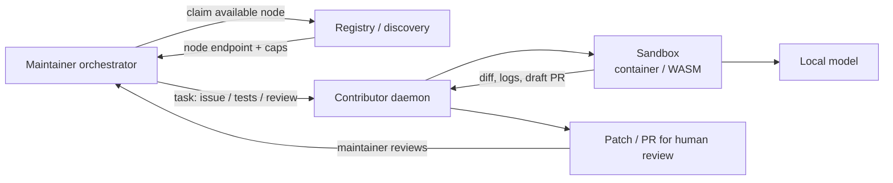

# agent-commons

**RFC / concept only.** Contributors donate a share of local compute so open-source maintainers can run coding agents on those machines — like cloud coding agents, but on volunteer nodes.

This repository is a design sketch, not an implementation. Feedback welcome via [Issues](https://github.com/andreluisfc/agent-commons/issues) or [Discussions](https://github.com/andreluisfc/agent-commons/discussions).

## Problem

Maintainers of open-source projects are increasingly bottlenecked by LLM tokens and compute. At the same time, many contributors have idle quota on local models and idle CPU/GPU capacity. Today there is no clean way to point that spare capacity at the maintainer's backlog (fix an issue, run tests, draft a PR review) without sharing API keys or trusting arbitrary remote code on a personal machine.

## Proposal

1. **Contributor daemon (opt-in).** A small agent installs on the contributor's machine. The contributor sets hard limits: which projects, how many hours, what fraction of CPU/GPU, and when the daemon may run. Limits are enforced locally; the maintainer cannot exceed them.

2. **Maintainer orchestrator.** The maintainer's agent discovers available contributor nodes (via a registry or peer discovery), then dispatches tasks such as:
   - investigate and propose a fix for a GitHub issue
   - run the test suite or a repro case
   - draft a PR review

3. **Human-gated results.** Nodes return patches, logs, or draft PRs. Nothing merges automatically. Humans review and accept or reject every change.

The net effect is more agent-hours on a project's backlog without buying cloud compute or pooling commercial API keys.

## Architecture sketch

Rough data flow:

- Orchestrator asks the registry which nodes are online and within their donated caps.
- It sends a self-contained task (repo clone URL, issue text, allowed commands) to a daemon.
- The daemon runs the task inside a sandbox that can talk only to the local model and a narrow allowlist of network endpoints (e.g. the public git host).
- Artifacts come back as a patch or draft PR; the orchestrator opens or updates a PR for humans.

## Security model

Running untrusted agent code on someone else's machine is the hard part. Baseline requirements:

- **Sandbox.** Tasks run in a container or WASM isolate. No host filesystem outside a scratch workspace. No access to the contributor's SSH keys, browser cookies, or other credentials.
- **No repo secrets.** Private deploy keys, `.env` files, and CI tokens stay with the maintainer. Nodes work on public clones or on ephemeral, scoped credentials that cannot write to protected branches.
- **Restricted network.** Default deny. Allow only the git host, the registry, and (optionally) package mirrors needed for the task.
- **Verification and reputation.** Nodes sign results. Maintainers (or a small set of trusted verifiers) check that patches actually build and that tests pass. Nodes that ship garbage or malicious diffs lose reputation and stop receiving work.
- **Redundant execution.** For higher-trust tasks, run the same job on two or more independent nodes and compare outputs before opening a PR.

None of this is solved here; these are the constraints an implementation must meet.

## Why local models

Sharing or proxying commercial API keys (OpenAI, Anthropic, and similar) typically violates those providers' terms of service. Contributor nodes should therefore run **local or open-weight models** on hardware they control. Donating "X% of my machine" means donating inference and tool-running time, not a slice of a paid API quota.

## Non-goals

- A marketplace that buys and sells tokens
- Crypto incentives, tokens, or mining-style rewards
- Pooling or forwarding commercial API keys
- Automatic merge of agent-produced PRs

## Prior art

Pieces of this idea already exist; none combine donated local compute with coding agents working on a maintainer's repo:

| Project | What it covers | Gap relative to this RFC |
| --- | --- | --- |
| [AI Horde](https://aihorde.net/) | Volunteer GPUs for short inference jobs | No coding agents, no repo workflows |
| [Petals](https://petals.dev/) / [Exo](https://github.com/exo-explore/exo) | Distributed inference across peers | Inference only |
| [PeerClaw](https://github.com/antonellof/peerclaw) | P2P agent network with sandboxed tools | Quota donation secondary |
| [Token Bank](https://github.com/wink-run/tokenbank) | Pool idle quota / compute | Weak on coding-agent + repo loop |
| [BusyDog BDP](https://github.com/Core-Mate/busydog-bdp) | Agent-to-agent protocol | No donated compute model |
| [agents-p2p-network](https://github.com/denizumutdereli/agents-p2p-network) | P2P agent mesh | Same |
| [MoltMesh](https://github.com/sahilpohare/MoltMesh) | P2P agent mesh | Same |
| [BOINC](https://boinc.berkeley.edu/) | Volunteer scientific compute | Not agent-shaped; no code/PR loop |

If something closer already exists, please open an issue and point to it.

## Open questions

1. Would you run a daemon like this for a project you already contribute to?
2. What is hardest in practice: sandboxing, result verification, or the economics of "why donate"?
3. Should discovery be a central registry, a DHT, or project-scoped invite links?
4. How should a node prove it ran the claimed model / toolchain without leaking the host?
5. What is the minimum viable first slice — tests only, or full "fix this issue" loops?

## Status

**Concept only.** There is no daemon, no orchestrator, and no production code in this repository yet.

Comments, counterexamples, and prior-art pointers are welcome:

- [Open an issue](https://github.com/andreluisfc/agent-commons/issues)
- [Start a Discussion](https://github.com/andreluisfc/agent-commons/discussions)

## License

[MIT](./LICENSE) © 2026 André Luis Finger Candido
